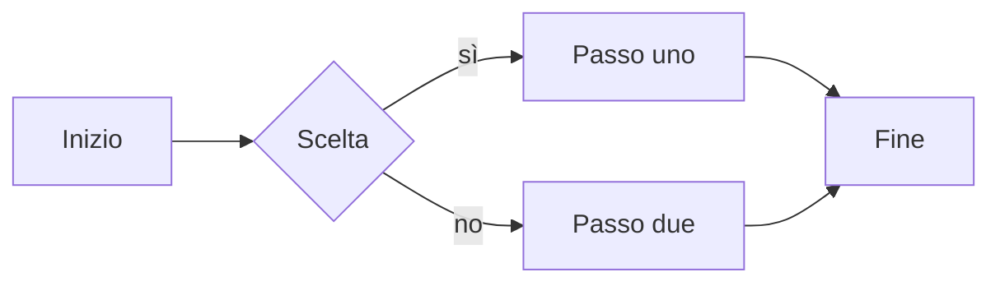
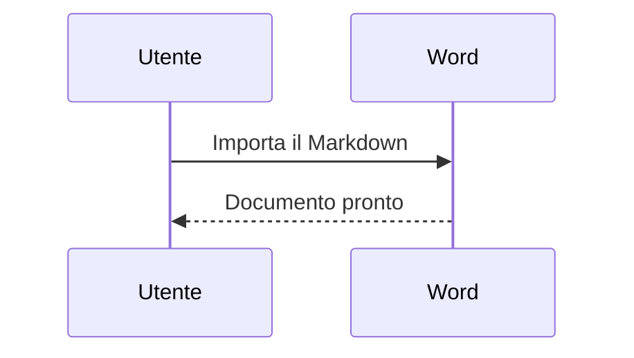
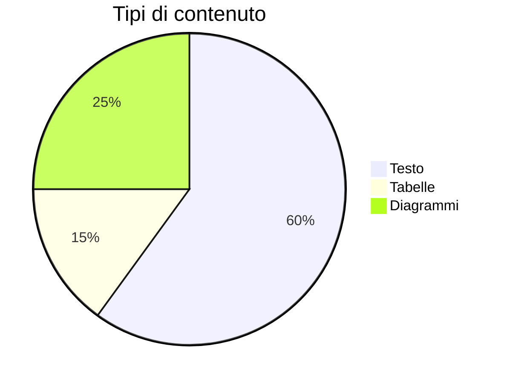
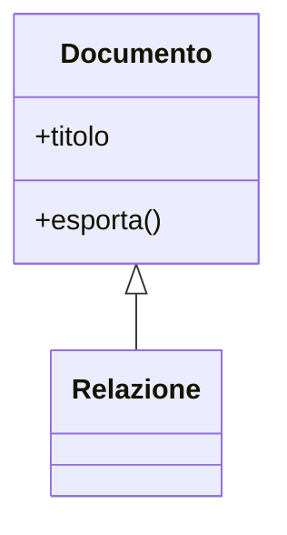

# Relazione di prova

Questo documento mostra **grassetto**, *corsivo*, ~~barrato~~, ==evidenziato==, `codice in linea`, H~2~O, x^2^ e un [collegamento esterno](https://example.com). Salta al [secondo livello](#secondo-livello)[^1].

## Secondo livello

> Una citazione su due righe,
> con un secondo paragrafo.

### Elenchi

- primo punto
- secondo punto
    - annidato
    - altro annidato
- [ ] da fare
- [x] fatto

1. uno
2. due
3. tre

Termine
: Definizione del termine

### Codice

```js
function saluta(nome) {
  return `Ciao ${nome}`;
}
```

### Tabella

| Voce       | Quantità | Prezzo |
|:-----------|:--------:|-------:|
| Mele       |    4     |   2,00 |
| Pere       |    10    |   3,50 |
| Arance     |    7     |   1,80 |

---

### Diagrammi










<!-- pagebreak -->

Ultima pagina: il testo dopo l'interruzione di pagina.

[^1]: Nota a piè di pagina con testo di esempio.
